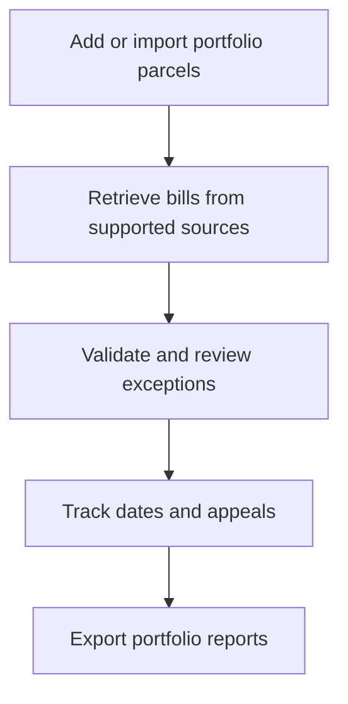

# Property tax operations with Retrieve-IQ

**Bring county bills, portfolio review, and appeal tracking into one workspace.**

Retrieve-IQ helps enterprise taxpayers and property-tax agent firms organize real-property tax work across jurisdictions. Connect a portfolio to supported county sources, review bills and exceptions, follow payment and appeal dates, and produce reports with the underlying evidence in view.

**[Open the beta application](https://retrieveiq-prod-web.onrender.com)** · **[Request beta access](mailto:team@retrieve-iq.com?subject=Property%20tax%20beta)**

> **Beta evaluation · Updated October 23, 2026**
> Access requires approved onboarding. County coverage and data availability are confirmed for each portfolio. The production URLs below serve the beta environment; service and data-retention expectations are agreed during onboarding.

## On this page

- [Who it is for](#who-it-is-for)
- [The portfolio workflow](#the-portfolio-workflow)
- [Production endpoints](#production-endpoints)
- [Join the beta program](#join-the-beta-program)
- [State coverage](#state-coverage)
- [What to expect during beta](#what-to-expect-during-beta)

## Who it is for

| Team | How Retrieve-IQ helps |
|------|----------------------|
| Enterprise property-tax teams | Review bills, assessments, and upcoming dates across a property portfolio |
| Agent firms | Work within authorized client engagements and keep client portfolio work organized |
| Portfolio and finance teams | Review liability forecasts, assessment changes, exceptions, and appeal outcomes |

The core use case is ongoing portfolio oversight: understanding what arrived, what needs review, what is due, and which assessments are under appeal.

## The portfolio workflow



### 1. Establish the portfolio

Add parcels individually or import a parcel CSV. Identify the relevant assessing and billing jurisdictions, and review coverage before relying on automated retrieval. For agent firms, onboarding also establishes the authorized client relationship.

### 2. Collect and review bills

Configured readers retrieve records from supported government portals. The bill inbox brings records into a review workflow with source documents and validation findings. Reviewers can accept, flag, or reject a bill.

A bill that fails reconciliation is retained for review and withheld from financial totals until its validation issues are cleared. Assessment year and payable year remain distinct, and missing payment information stays unknown rather than being treated as zero paid.

### 3. Follow payment and appeal dates

The calendar brings together installment dates and derived appeal windows. A subscribable iCal feed makes available dates accessible from a calendar client.

Dates depend on the jurisdiction rules and events that have been recorded. Missing information remains visible; some rules produce a date bound rather than an exact deadline. Confirm important dates against the issuing authority's current notices.

### 4. Track appeals

Record appeals against an assessment year and follow their lifecycle: open, filed, decided, withdrawn, or reopened. Track requested and decided values alongside the parcel record.

Where sufficient inputs exist, the overview can show modelled appeal upside. This is an estimate with missing-input counts, rather than a guaranteed saving. Recording an appeal as filed does not submit it to an authority.

### 5. Report on the portfolio

Reports are generated as background jobs and can be exported in CSV, XLSX, or PDF.

| Report | Purpose |
|--------|---------|
| Assessed value roll-forward | Compare assessment years and identify changes |
| Tax liability forecast | Review available billed amounts and forecast inputs |
| Deadline exposure register | See recorded dates and deadline exposure |
| Bill ingestion audit | Trace bill sources, processing, review, and outstanding checks |
| Appeal outcomes and savings | Review requested and decided values and savings where known |

Availability of these workflows in an individual beta workspace depends on its configuration, source data, and enabled background jobs.

## Production endpoints

| Service | Production address | Access |
|---------|--------------------|--------|
| Frontend | [retrieveiq-prod-web.onrender.com](https://retrieveiq-prod-web.onrender.com) | Open in a browser; approved sign-in is required for workspace access |
| API base | `https://retrieveiq-prod-api.onrender.com` | Base address for API routes |
| GraphQL API | `POST https://retrieveiq-prod-api.onrender.com/graphql` | Authenticated product requests |
| API readiness | [GET /readyz](https://retrieveiq-prod-api.onrender.com/readyz) | Public readiness and database-connection check |
| API health | [GET /healthz](https://retrieveiq-prod-api.onrender.com/healthz) | Public process-liveness check |

An API base URL is not a browsable application. Product API requests require an authorized credential; opening the frontend or creating an identity does not automatically grant workspace membership.

For a public connectivity check:

```sh
curl --fail --show-error https://retrieveiq-prod-api.onrender.com/readyz
```

A successful response reports `status: "ok"` and `database: "connected"`. This establishes readiness at the time of the request; it does not validate every county reader or portfolio workflow.

The frontend, API health, and API readiness endpoints responded successfully on October 23, 2026. An anonymous GraphQL request was refused with HTTP 401. These checks did not exercise an authenticated user workflow or audit production coverage data.

## Join the beta program

**[Email team@retrieve-iq.com to request a beta evaluation](mailto:team@retrieve-iq.com?subject=Property%20tax%20beta).**

Include the following so the team can assess the fit:

- Your organization and whether you are a taxpayer, agent firm, or integration team.
- The states and counties in your portfolio and an approximate parcel count.
- Your priority workflow: bill review, portfolio reporting, appeal tracking, or API integration.
- The outcome you would like to evaluate during the pilot.

Use the initial message for an overview. The team can arrange an appropriate channel for detailed portfolio files and access information.

### How onboarding works

1. **Review the fit.** Confirm the jurisdictions, sources, and workflows needed for the evaluation.
2. **Agree the pilot scope.** Establish the portfolio, available data, refresh arrangements, support contact, and service expectations.
3. **Approve access.** Configure the workspace and enroll approved identities; agent access requires the appropriate client relationship.
4. **Run a focused evaluation.** Work through a small portfolio, review exceptions, and validate the reports and dates against source records.
5. **Share feedback.** Report usability gaps and missing coverage to the beta team. Public documentation corrections can be raised in [GitHub Issues](https://github.com/retrieve-IQ/.github/issues).

There is no self-service workspace activation described in this guide. Participation terms, pricing, and any support commitments are confirmed directly with the team.

## State coverage

### A national registry, with coverage assessed locally

The reference registry includes all **50 states and the District of Columbia**. Within that registry, **920 county-level units across 33 states** are recorded with at least one portal marked `covered` in the reviewed source dataset.

These are **recorded reader-coverage counts**, not a claim of complete statewide service. A state's presence does not establish support for every county, property, tax year, bill type, municipal collector, or appeal rule. Reference records also need to be loaded and the relevant jobs enabled in a beta environment.

### States with covered entries

| State | County-level units recorded covered |
|-------|------------------------------------:|
| Alabama | 28 |
| Arizona | 2 |
| California | 57 |
| Colorado | 7 |
| Florida | 24 |
| Georgia | 22 |
| Illinois | 49 |
| Indiana | 76 |
| Iowa | 34 |
| Kansas | 40 |
| Kentucky | 61 |
| Maryland | 2 |
| Minnesota | 27 |
| Mississippi | 14 |
| Missouri | 28 |
| Montana | 22 |
| Nebraska | 77 |
| Nevada | 5 |
| New York | 1 |
| North Carolina | 18 |
| North Dakota | 1 |
| Oklahoma | 74 |
| Oregon | 4 |
| South Carolina | 25 |
| South Dakota | 18 |
| Tennessee | 24 |
| Texas | 62 |
| Utah | 3 |
| Virginia | 12 |
| Washington | 10 |
| West Virginia | 49 |
| Wisconsin | 39 |
| Wyoming | 5 |
| **Total** | **920** |

**California:** 57 of the 58 counties are marked covered in the reviewed dataset. Kern County is excluded pending an approved source.

### States and DC without covered entries in this snapshot

Alaska, Arkansas, Connecticut, Delaware, District of Columbia, Hawaii, Idaho, Louisiana, Maine, Massachusetts, Michigan, New Hampshire, New Jersey, New Mexico, Ohio, Pennsylvania, Rhode Island, and Vermont have no units marked `covered` in this snapshot. Some have identified portals or candidate readers; those stages do not count as covered.

Ask the beta team to review an exact jurisdiction even when its state appears above. Municipal, township, school-district, and other billing arrangements require their own checks.

### Understanding the coverage labels

| Label | What it tells you |
|-------|-------------------|
| Covered | The reference data records a working reader for a portal; confirm its freshness and availability for your portfolio |
| Reader ready | A reader and configuration are present, awaiting the jurisdiction's live check |
| Portal found | A portal is known, with reader work still needed |
| Closed / no portal | Automated retrieval is unavailable or no online bill portal is recorded |
| Assessment only | The recorded source does not issue a bill of its own |
| Not surveyed | No portal record is available yet |

For enrolled users, the application's **Coverage** screen provides the environment's loaded state and jurisdiction details. Source-level counts on this page are separate from the live environment's inventory.

<details>
<summary>Snapshot date and methodology</summary>

Reviewed October 23, 2026 against platform source revision `ce2c3eb`. Counts join the versioned jurisdiction registry to portal records, count each unit once when at least one portal has status `covered`, and use the platform's county-level definition: counties, parishes, independent cities, and Alaska boroughs. Every covered entry in this snapshot is county-level.

The dated covered-portal checks in the dataset range from September 10 through September 21, 2026. California's 57 covered entries were generated from existing reader bindings and carry no per-portal verification date. No new county live checks were performed for this publication. Counts therefore describe the source snapshot and do not certify present-day availability or a completed production import.

</details>

## What to expect during beta

- **Guided access and portfolio setup.** Reference-data loading and automated refresh are confirmed during onboarding.
- **A service that may need to warm up.** The current beta uses free Render infrastructure; an idle API can take about a minute to start. [Render documents its free-service limits](https://render.com/docs/free).
- **Evaluation hosting.** The current hosting setup has capacity, database-lifetime, and backup limitations. Agree retention and recovery expectations with the team before treating the beta as an operational system of record.
- **Clear product boundaries.** Retrieve-IQ tracks and validates bills; it does not execute payments. Appeal evidence-pack assembly, hearing scheduling, generic document-upload/OCR review, and automated notification workflows are outside the current implemented scope.

**Next step:** [Request a beta evaluation](mailto:team@retrieve-iq.com?subject=Property%20tax%20beta) with your target states and counties, or [open the application](https://retrieveiq-prod-web.onrender.com) if your access is already approved.

[Documentation index](README.md) · [Organization profile](https://github.com/retrieve-IQ)
